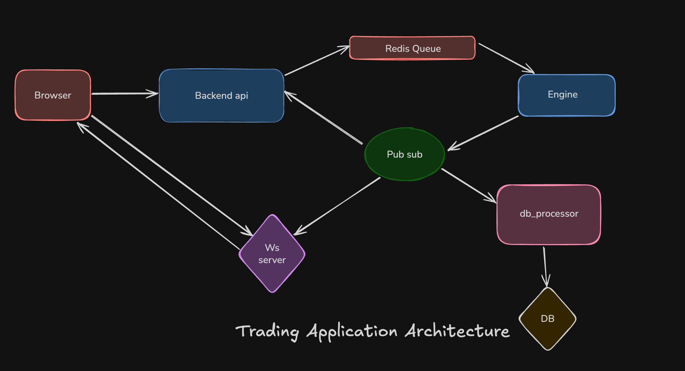

# Centralised exchange

I happen to learn some Finance terms before building this, here are some

- Limit Order - Buy/sell an asset at a particular price, the trade might not execute immediately.
- Market Order - Buy/sell an asset at the best available price, trade will happen immediately.
- Order Book - List of all buy and sell orders, sorted by price. 
- Liquidity - How easily an asset can be bought/sold. More liquid an exchange is, the better is the exchange 
- Spread - Difference between the highest buy price and lowest sell price, lesser the spread, more the liquidity.
- Maker / Market maker - someone who adds liquidity, by adding orders on both sides, in order for trades to be executed smoothly, companies like Citadel provides these making, in return they get better prices, lesser trading fees etc. 
- Slippage - Difference between expected price and the actual price, may arise due to latency, or other reasons. We can put an upper cap.
- Leverage - Borrowing money to trade bigger positions, higher the leverage, your position in the asset becomes higher
- Margin - The amount we put against getting leverage, once the margin we put is exhausted, our leveraged position is closed.
- Arbitrage - Buying low on one market, selling high on another for profit.
- Limit price - Even while making a market order, an upper cap to the price of asset is automatically put in order to get the asset at a fair price. This is also known as quote of the order. 
- Price of an asset - is the price at which the last trade of that asset happened.
- Depth - shows quantity of orders (both buy and sell) available at a particular time
- Ticker - just a snapshot of the market at a particular instance of time

## Project Architecture



## About

Centralised exchanges are fascinating. This repo is my naive attempt, to mimic the architecture of a trading exchange. I am using a distributed
system approach, to keep things persistent, scalable and fast. 

A primary metric in these systems is the trade execution time. I was able to achieve sub 10ms latency running my app locally, which is considered good.

### Components Breakdown

- **Backend API (TypeScript)**  
  → Entry point for all client actions.  
  → Forwards trade/order requests to Redis Queue and handles responses through Pub/Sub.

- **Redis Queue**  
  → Message queue ensuring asynchronous, high-throughput communication between backend and engine.

- **Engine**  
  → Core trading logic lives here.  
  → Maintains in-memory **order books**, and user balances,  matches buy/sell orders, and publishes trade events.

- **Pub/Sub System (Redis)**  
  → Facilitates real-time communication between backend, engine, WebSocket server, and database processor.

- **WebSocket Server**  
  → Streams live tickers, trades, and order book updates directly to browsers.

- **DB Processor**  
  → Listens to trade events via Pub/Sub and updates the database asynchronously.

- **Database (Postgres)**  
  → Persistent store for trades.

- Docker 
 -> For running the entire app, run `docker compose up --build`
---

## Crash recovery

The engine keeps the order book and balances in memory, so it persists two things to the `engine-data` Docker volume (`/app/data`):

- **Event log** (`events.log`): an append-only JSON-lines file with one record per state-changing command (`CREATE_ORDER`, `CANCEL_ORDER`, `ADD_BALANCE`). Each record has a sequence number and the engine-assigned order id. `CREATE_ORDER` records also store the fills the order produced. The engine applies a command in memory, appends the record and `fsync`s it, and only then publishes trades and depth and replies to the API. So anything a client was told about is already on disk.
- **Snapshots** (`snapshot.json`): every `SNAPSHOT_INTERVAL_MS` (3 s by default), and only when something changed, the full book and balances are written together with `lastSeq`. The write goes to a temp file, which is `fsync`ed and then renamed (the directory is `fsync`ed too), so a crash leaves either the old snapshot or the new one, never half a file.

On startup the engine loads the latest snapshot (or the genesis balances if there is none) and replays every logged event with `seq > lastSeq`. Replay re-runs the matching logic without publishing anything, so trades are not sent to the DB again. It also checks that each replayed order produces exactly the fills that were logged. If the last line of the log is torn because the process died mid-append, that line is cut off.

Code: `engine/src/persistence/store.ts` and `recover()` / `persist()` in `engine/src/trade/engine.ts`.

### Test

```
./scripts/crash-recovery-test.sh        # BURST=3000 for a bigger mid-flow burst
```

Warning: this wipes the engine's state (the engine container and the `engine-data` volume). Postgres and Redis are left alone. The script runs two scenarios and prints `RESULT: PASS` or `RESULT: FAIL`.

1. **Quiesced crash.** Place orders, wait for a snapshot, then place more orders, including a fill and a cancel. Record the depth, open orders and balances, `docker kill -s KILL engine`, and restart. The state must be byte-identical.
2. **Crash mid-flow.** Fire 300 non-crossing orders from 16 concurrent clients and SIGKILL the engine once about a quarter of them have been acknowledged. After the restart, every order acknowledged before the kill must be in the book. There must be no phantom orders, total USDC and SOL must be conserved, and the scenario-1 orders must be unchanged.

Measured locally (Docker Desktop on macOS, 2026-11-18):

| | events replayed | replay time | `docker start` → first API answer |
|---|---|---|---|
| Scenario 1 (4 runs) | 4 (after snapshot seq=5) | 0–1 ms | 290–426 ms |
| Scenario 2, 300 orders (4 runs) | 93–100 | 2–3 ms | 298–470 ms |
| Scenario 2, `BURST=3000` | 325 (after snapshot seq=468) | 7 ms | n/a |
| Full log, snapshot deleted | 3009 (from genesis) | 65 ms | n/a |

The restart time is almost all container and Node startup plus the test's 100 ms polling, not replay. Before this change the same test failed. By default the engine came back with genesis balances and an empty book. With the old `SNAPSHOT=1` flag it lost everything after the last 3 s snapshot.

Caveats:

- The engine pops from the Redis `messages` list with `RPOP`. A command that has been popped but not yet logged when the engine dies is lost. Its client never gets a reply (the API waits forever, since `sendAndWait` has no timeout). Commands still in the list survive because Redis wasn't killed. The reverse can also happen: a command can be logged but its reply lost. In 3 of the 4 runs with 300 orders, one client never got an answer even though its order was in the book. I didn't pin down whether that reply was lost in the crash or in the API's subscribe-then-push race.
- `docker kill` only kills the process, so the page cache survives and the test does not prove the `fsync`s. Power loss or a VM crash is not tested. The latency cost of one `fsync` per command was not measured.
- The log is never compacted or rotated, so it grows forever. Startup only replays events after the snapshot, but it reads the whole file.
- Replay is deterministic only because matching uses no clocks or randomness (the order id is logged). It reproduces existing matching bugs faithfully instead of fixing them.
